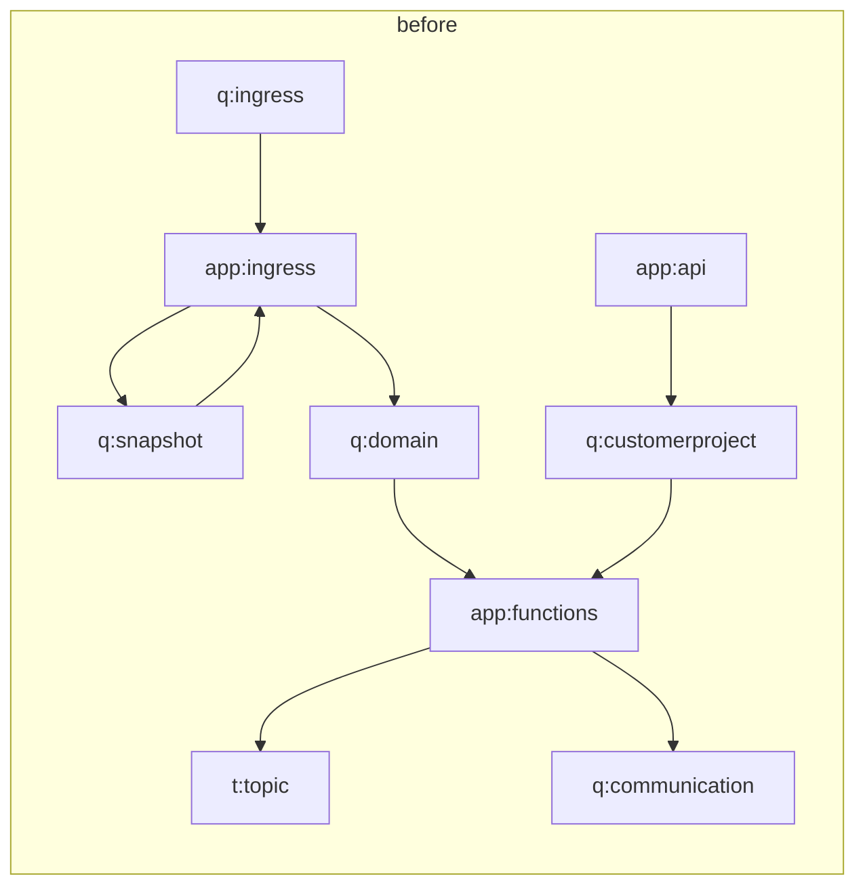
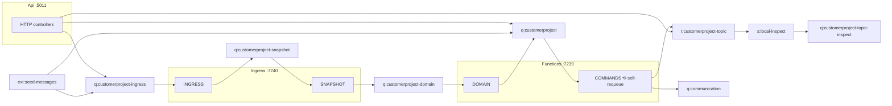

# ADDENDA-008 — Flow: handler nodes + containers (registration schema v2)

Status: Proposed (Architect, Nov 4 2026) · Amends ADR-002 (registration), ADR-003 (flow model), HANDOFF-ui-ux-data-contracts (FlowGraph, positions).
Source: Bjor Flow change Nov 4 via Team Lead. Reference scan of `/workspace/dsp/dsp-customerproject` was **read-only** (rg only, no edits, no git writes). No secrets.

## 1. Decisions
1. **Handler node** = one logical message handler (one `[Function]` + its trigger). Handlers are Flow nodes even when several share one host app.
2. **Container** = a labelled box around nodes. Edges never target a container; containers are layout/grouping only.
3. **Multi-resource logic (rare DOMAIN case):** one flat level, no nesting. A container has `kind: "resource" | "logical"`; a `logical` container lists **several** `resourceRefs` (app ids). A node belongs to at most one container. If DOMAIN spans resources, it gets its own `logical` container and is removed from the resource container. Not needed for customerproject today.
4. **Entities (queues/topics/subscriptions) stay standalone nodes outside every container** (they are state, not compute).
5. **Invariant I-1:** for every queue/subscription Q and node N, edges `N→Q` and `Q→N` must not both exist. A handler that re-sends to its own trigger queue is a **self-requeue**: rendered as a badge on the handler (`selfRequeue[]`), never as an edge. Generator fails (non-zero) on any other violation.

## 2. customerproject mapping (read-only scan)

| Function | Host app | Trigger | Handler node | Outbound (source file:line) |
|---|---|---|---|---|
| IngressQueueHandler | Ingress :7240 | q:customerproject-ingress | `customerproject.fn.ingress` | q:customerproject-snapshot — `Ingress.Application/Import/ChangeEventHandlerBase.cs:52` (via 6 *ChangedHandler) |
| SnapshotQueueHandler | Ingress :7240 | q:customerproject-snapshot | `customerproject.fn.snapshot` | q:customerproject-domain — `Ingress.Application/CreateIngressSnapshot/CreateCustomerAddressSnapshotOn*Handler.cs:28` (+ CreateProjectWithPriceSnapshotOn*), `SendBatchAsync` via IDomainQueueClient |
| CustomerProjectDomainQueueHandler | Functions :7239 | q:customerproject-domain | `customerproject.fn.domain` | q:customerproject — `Application/Features/UpdateFromIngressSnapshot/UpdateCustomerAddressFromSnapshotHandler.cs:60,69` |
| CustomerProjectQueueHandler | Functions :7239 | q:customerproject (cloud also via sub customerproject-to-customerproject) | `customerproject.fn.commands` | t:customerproject-topic — `Application/Features/Upsert/CustomerProject/CustomerProjectService.cs:222`, `CreateFromErpReferenceHandler.cs:89`, `CustomerAddressChangedHandler.cs:68`; q:communication — `Integrations.Communication/NotificationSender.cs:64` → `Client/CommunicationQueueClient.cs:43`; **self-requeue** q:customerproject — `CreateMissingProjectsHandler.cs:59`, `SyncProjectDatesHandler.cs:52`, `CustomerProjectService.cs:227`, `CreateFromErpReferenceHandler.cs:51`, `CustomerAddressChangedHandler.cs:64`, `Notification/OrderDeliveredHandler.cs:34`, `OrderReferenceChangedHandler.cs:26`, `ValidateOrderHandler.cs:81,90` (scheduled) |
| (HTTP controllers, not a Function) | Api :5011 | HTTP | `customerproject.api.http` | q:customerproject — `Api/V1/Controllers/CustomerProjectController.cs:238,253,272,292,306`, `OrderAssociationController.cs:119`, `ImageController.cs:134`; t:customerproject-topic — `Application/Features/OrderAssociation/ManualAssociationService.cs:126`; q:customerproject-ingress — client registered `Api/Program.cs:69`, **no send call found** (see OQ-2) |

Paths are relative to `src/Dahl.CustomerProject.`. No HttpTrigger / TimerTrigger functions exist. Retry inside `HandleWithRetry` (Dahl.Core `MessageHandler` base, NuGet, not in repo) is infrastructure and not drawn.

Functions found: **4** SB-triggered (2 in Functions, 2 in Ingress) + the Api HTTP surface = **5 handler nodes**.

## 3. Node + container ids

| Container id | kind | label | resourceRefs | members |
|---|---|---|---|---|
| `container:customerproject.api` | resource | Api :5011 | `app:api` | `customerproject.api.http` |
| `container:customerproject.func-app` | resource | Functions :7239 | `app:functions` | `customerproject.fn.commands`, `customerproject.fn.domain` |
| `container:customerproject.ingress-app` | resource | Ingress :7240 | `app:ingress` | `customerproject.fn.ingress`, `customerproject.fn.snapshot` |

Note: DOMAIN is hosted in Functions but its queue client comes from `Ingress.Messaging` (`DomainQueueClient`). That is a shared library, not a second resource → stays in `func-app` (no logical container).

Id rules: handler `{projectId}.fn.{short}` (short = function name minus `QueueHandler`, kebab-case, `CustomerProject` prefix dropped; override via `overrides.handlerIds`), http surface `{projectId}.{app}.http`, container `container:{projectId}.{appShort}`. App ids (`app:*`) remain in `apps[]` as **resources** (attach/run/logs/cloudRoleName) but are no longer Flow nodes.

## 4. Schema fragment (registration.schema.json, `schemaVersion: 2`)
```json
{
  "schemaVersion": { "const": 2 },
  "containers": { "type": "array", "items": {
    "type": "object", "required": ["id","label","kind","resourceRefs"], "additionalProperties": false,
    "properties": {
      "id": { "type": "string", "pattern": "^container:[a-z0-9.-]+$" },
      "label": { "type": "string" },
      "kind": { "enum": ["resource","logical"] },
      "resourceRefs": { "type": "array", "items": { "type": "string", "pattern": "^app:" }, "minItems": 1 },
      "scope": { "enum": ["local","cloud","both"], "default": "both" }
    },
    "allOf": [{ "if": { "properties": { "kind": { "const": "resource" } } },
               "then": { "properties": { "resourceRefs": { "maxItems": 1 } } } }]
  }},
  "handlers": { "type": "array", "items": {
    "type": "object", "required": ["id","label","appId","containerId","triggers"], "additionalProperties": false,
    "properties": {
      "id": { "type": "string" }, "label": { "type": "string" },
      "appId": { "type": "string", "pattern": "^app:" },
      "containerId": { "type": "string", "pattern": "^container:" },
      "triggers": { "type": "array", "items": { "type": "object", "required": ["kind"],
        "properties": { "kind": { "enum": ["servicebus","http","timer"] }, "function": {"type":"string"},
          "entityId": {"type":"string"}, "setting": {"type":"string"}, "connection": {"type":"string"}, "sourceFile": {"type":"string"} } } },
      "selfRequeue": { "type": "array", "items": { "type": "object", "required": ["entityId"],
        "properties": { "entityId": {"type":"string"}, "messages": {"type":"array","items":{"type":"string"}}, "sources": {"type":"array","items":{"type":"string"}} } } }
    }
  }}
}
```
Schema notes: `apps[].triggers` is **removed** in v2 (moved to `handlers[].triggers`). Edges: `from`/`to` must be a handler id, entity id or `ext:*`; never `container:*` or `app:*` (validator V-2). Cross-field checks (not expressible in JSON Schema) live in the generator + API loader: V-1 every `containerId` exists; V-2 edge endpoints; V-3 handler `appId` ∈ container `resourceRefs`; V-4 invariant I-1; V-5 each trigger entity has exactly one `trigger` edge to its handler.

Example (customerproject.dev.json, excerpt):
```json
"schemaVersion": 2,
"containers": [
  { "id": "container:customerproject.func-app", "label": "Functions :7239", "kind": "resource", "resourceRefs": ["app:functions"] },
  { "id": "container:customerproject.ingress-app", "label": "Ingress :7240", "kind": "resource", "resourceRefs": ["app:ingress"] },
  { "id": "container:customerproject.api", "label": "Api :5011", "kind": "resource", "resourceRefs": ["app:api"] }
],
"handlers": [
  { "id": "customerproject.fn.ingress", "label": "INGRESS", "appId": "app:ingress", "containerId": "container:customerproject.ingress-app",
    "triggers": [{ "kind": "servicebus", "function": "IngressQueueHandler", "entityId": "q:customerproject-ingress", "setting": "ServiceBusCustomerProjectIngressQueue", "connection": "ServiceBusNamespace", "sourceFile": "src/Dahl.CustomerProject.Ingress.Functions/Functions/IngressQueueHandler.cs" }] },
  { "id": "customerproject.fn.commands", "label": "COMMANDS", "appId": "app:functions", "containerId": "container:customerproject.func-app",
    "triggers": [{ "kind": "servicebus", "function": "CustomerProjectQueueHandler", "entityId": "q:customerproject", "setting": "ServiceBusCustomerProjectQueue", "connection": "ServiceBusConnectionString" }],
    "selfRequeue": [{ "entityId": "q:customerproject", "messages": ["CreateProjectsFromErpReferences","HandleCustomerAddressChanged","PopulateOrderReferences","ValidateOrder","SendNotification"], "generated": true }] }
],
"edges": [
  { "kind": "trigger", "from": "q:customerproject-snapshot", "to": "customerproject.fn.snapshot", "scope": "both" },
  { "kind": "publish", "from": "customerproject.fn.snapshot", "to": "q:customerproject-domain", "scope": "both" },
  { "kind": "publish", "from": "customerproject.fn.domain", "to": "q:customerproject", "label": "Upsert* commands", "scope": "both" }
]
```

### Edge rewrite of the current 15 local edges
| Old | New |
|---|---|
| q:customerproject-domain → app:functions | → `fn.domain` |
| q:customerproject → app:functions | → `fn.commands` |
| q:customerproject-ingress → app:ingress | → `fn.ingress` |
| q:customerproject-snapshot → app:ingress | → `fn.snapshot` |
| app:api → q:customerproject / -ingress / topic | `api.http` → same |
| app:functions → topic, → q:communication | `fn.commands` → same |
| app:ingress → q:customerproject-snapshot | `fn.ingress` → same |
| app:ingress → q:customerproject-domain | `fn.snapshot` → same |
| *(new, was hidden by app merge)* | `fn.domain` → q:customerproject |
| seed / subscription / forward edges | unchanged |

## 5. Invariant I-1 check (customerproject)
Before (app nodes): **violations** — `app:ingress` ↔ q:customerproject-snapshot (consumes and sends), `app:functions` ↔ q:customerproject (domain→commands send).
After (handler nodes):
| Queue | Pair | Result |
|---|---|---|
| q:customerproject-snapshot | fn.ingress → Q → fn.snapshot | OK |
| q:customerproject-domain | fn.snapshot → Q → fn.domain | OK |
| q:customerproject | fn.domain/api.http → Q → fn.commands | OK |
| q:customerproject | fn.commands → Q (self-requeue) | **Violation → resolved** as `selfRequeue` badge (no edge) |
| q:customerproject (cloud) | fn.commands → topic → sub customerproject-to-customerproject → Q → fn.commands | Cycle through other entities; I-1 is about direct pairs only → OK (UI may show cycle hint) |

Generator rule: after edge synthesis, for each entity E collect `ins = {from of edges to E}` and `outs = {to of trigger edges from E}`; for N ∈ ins ∩ outs: if N is a handler whose own trigger is E → move to `N.selfRequeue` and drop the edge; else **error** `I1_VIOLATION {entity, node}` (exit 2), unless `overrides.allowBidirectional[]` lists it (escape hatch, should stay empty).

## 6. FlowGraph contract delta (TypeScript)
```ts
type FlowContainer = {
  id: string;                 // "container:customerproject.func-app"
  label: string; kind: "resource" | "logical";
  resourceRefs: string[];     // app ids; drives attach/logs/cloudRoleName actions on the box header
  app?: FlowAppInfo;          // resource containers only (port, cloudRoleName, attached)
  scope: "local" | "cloud" | "both";
  position?: { x: number; y: number };     // absolute, stored
  size?: { w: number; h: number };         // hint; UI recomputes from children + padding
};
type FlowNode = { /* existing */ kind: "handler" | "queue" | "topic" | "subscription" | "external";
  containerId?: string;                    // handlers only
  position?: { x: number; y: number };     // RELATIVE to container origin when containerId set, else absolute
  handler?: { functions: string[]; triggerEntityIds: string[]; selfRequeue: { entityId: string; messages: string[] }[] };
};
type FlowGraph = { /* existing */ schemaVersion: 2; containers: FlowContainer[];
  layoutHints: { containerPadding: number; innerDirection: "LR" | "TB" } };
```
`kind: "app"` nodes disappear. UI: render containers as React Flow parent/group nodes (`parentId` = containerId, `extent: "parent"`); edges only between node ids; entities never parented. Auto-layout: ELK compound graph (`elk.hierarchyHandling: INCLUDE_CHILDREN`) or dagre clusters.

## 7. Position / drag persistence
**Today (read from code):** server file `data/flow-positions/{projectId}.json`, a flat `{ nodeId: {x,y} }` map (`FlowPositionStore`), keyed by raw node id (e.g. `app:functions`), no env, no version. `PUT /flow/positions` merges and **drops ids not in `AllNodeIds`** (`MergeAsync`). Empty PUT = reset. localStorage holds only the legend toggle (`LEGEND_KEY`), no positions.

**v2 file** (same path; key includes env so dev/other envs don't clash):
```json
{ "version": 2,
  "positions": {
    "pos:customerproject:dev:container:customerproject.func-app": { "x": 420, "y": 80 },
    "pos:customerproject:dev:customerproject.fn.domain": { "x": 24, "y": 40 },
    "pos:customerproject:dev:q:customerproject": { "x": 760, "y": 120 }
  } }
```
- Keys: node `pos:{projectId}:{env}:{nodeId}`, container `pos:{projectId}:{env}:container:{containerId-without-prefix}`.
- Inner nodes store coordinates **relative** to container origin (relativity follows from the node's `containerId`). Dragging a container rewrites only the container key; children move with it. Dragging a child rewrites only its relative key (clamped to parent extent).
- API wire format stays `{ id: {x,y} }` keyed by **graph id** (container or node id); the store maps to `pos:` keys server-side. GET returns container positions absolute, inner positions relative.
- Migration (on Load, in memory; written on next PUT; idempotent):
  1. File without `version` ⇒ v1 map. For each key: `app:X` → container key for container whose `resourceRefs` contains `app:X`; entity/ext ids → `pos:{p}:{env}:{id}` unchanged value.
  2. Inner handler nodes get **no** stored position → auto-laid out inside the container (layout = `partial`).
  3. Re-running on a v2 file is a no-op. No v1 rollback (v1 code treats a v2 file as corrupt) — accepted.
  4. **Never drop unknown keys:** `MergeAsync` must stop filtering by `knownNodeIds` on retained data; unknown keys are kept verbatim (hidden). Writes keep today's behaviour: unknown ids in a PUT are ignored (no 400), so stale UI maps after a regen don't break.
  5. Reset layout (empty PUT) clears that env's `pos:{p}:{env}:*` keys and writes the file (no delete) so other keys survive.

## 8. Before / after



## 9. Generator changes (Slice 6, Developer)
1. Emit `schemaVersion: 2`, `containers[]` (one `resource` container per app), `handlers[]` (one per `[Function]` with ServiceBus/Http/Timer trigger; one `*.http` handler per web app).
2. Outbound attribution per handler: resolve sender classes (`*QueueClient : QueueClientBase` → `settings.X` → config key → entity; `*TopicClient : TopicClientBase`; `CreateSender(settings.X)`) and walk DI-injected handler classes reachable from the Function's constructor (`Lazy<T>`/interfaces) to their `SendAsync/SendBatchAsync/SendMessage` calls. Record `sources` file:line. If attribution is ambiguous, fall back to app-level: emit the edge from every handler in the app with `confidence: "inferred-from-settings"` and a warning.
3. Run validators V-1..V-5 incl. I-1 rewrite; fail on unresolved I-1.
4. `overrides`: `handlerIds`, `handlerLabels` (INGRESS/SNAPSHOT/DOMAIN/COMMANDS), `logicalContainers[]` (id, label, resourceRefs, members), `allowBidirectional[]`.
5. API: `FlowGraphBuilder` builds container + handler nodes; `AllNodeIds` includes containers; `FlowPositionStore` v2 + migration (§7). Tests: migration idempotence, unknown keys survive, I-1 fixture violation, edge to container rejected.

## 10. Open questions
- OQ-1 COMMANDS self-requeue: badge (chosen) vs. a dashed loop edge? Bjor/UI to confirm.
- OQ-2 `api.http → q:customerproject-ingress`: client is registered (`Api/Program.cs:69`) but no send call found in Api. Keep edge as `confidence: inferred` or drop? Recommend drop unless a call is found.
- OQ-3 Should COMMANDS be split further per message type (e.g. notifications vs upsert)? Not a separate Function today, so no (handler = Function).
- OQ-4 `HandleWithRetry` resend semantics live in Dahl.Core (NuGet); confirm retry is reschedule-to-same-queue (would also be self-requeue, not drawn).
- OQ-5 Cloud subscription `customerproject-to-customerproject` makes a topic-mediated loop COMMANDS→topic→QC→COMMANDS; show a cycle hint?

## 11. Review revisions (fable review, Nov 4) — normative, override earlier sections where they conflict
- **I-1 precise rule.** `ins(E)` = sources of `publish|forward|inject` edges into E; `outs(E)` = targets of `trigger` edges from E. For N in both: if N's send to E is attributed with `confidence: "code"` (file:line found in N's call graph) → move to `N.selfRequeue` (generator-derived, `generated: true`, never hand-edited) and drop the edge. If the publish edge is `inferred-from-settings` (app-level fallback, §9.2) → **error `I1_UNRESOLVED`**, not a badge: a mis-attribution must never become a false self-requeue. `allowBidirectional[]` override is the only escape. customerproject: the only hit is COMMANDS/q:customerproject, code-attributed → badge.
- **Confidence:** edges with handler-level file:line become `code`; fallback edges `inferred-from-settings` (existing enum; no new value).
- **Ids:** `{projectId}` in handler/container/position ids = registration `project` field (`customerproject`), `{env}` = `env` (`dev`). Position file path stays `PathFor(registration id)` (`customerproject.dev.json`); the env segment keeps keys self-describing if files are ever merged.
- **containerId** is generator output: for `resource` containers it is derived from `appId`; `overrides.logicalContainers[].members` is the single input source for logical membership. Moving a handler into a logical container invalidates its relative position (dropped → auto-layout inside new parent; key kept under old container id is ignored, not deleted).
- **One Function per handler:** `FlowNode.handler.function: string` (singular), not `functions[]`. Exception: `*.http` handler has `function` omitted.
- **Schema tightening:** trigger items `additionalProperties: false`; `entityId` required when `kind: servicebus`; handlers get `scope` (default = container scope); missing `schemaVersion` ⇒ 1 (loader accepts v1 and upgrades in memory); V-5 relaxed to "≥1 trigger edge per handler trigger" (competing consumers allowed).
- **UI change required (add to §9):** FlowTab must honour stored positions **per node** (today it uses stored coords only when *all* nodes have one, `FlowTab.tsx:119`, `:252`). New `layout: "partial"` in FlowGraph: stored nodes/containers pinned, others auto-laid (ELK with fixed positions / interactive mode). Without this, migrated container positions are discarded.
